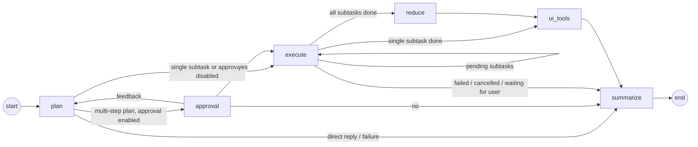

# Architecture

The Rancher AI Agent uses a [subagents](https://docs.langchain.com/oss/python/langchain/multi-agent/subagents) architecture built on LangGraph. Specialized **child agents** are loaded from AIAgentConfig CRDs, each connected to its own MCP server. Depending on how many agents are available to the user and on the deployment configuration, one of three runtime modes is used (see `app/services/agent/factory.py`):

| Mode | When | How it works |
|------|------|--------------|
| **Single agent** | Only one agent is accessible (or only one connects successfully) | The child agent talks to the user directly. |
| **Supervisor** | Two or more agents, planner mode disabled (default) | A ReAct **supervisor agent** wraps each child agent as a LangChain tool; its LLM decides which agent(s) to invoke, coordinates their results, and synthesizes a final response. |
| **Planner** | Two or more agents and `PLAN_ENABLED=true` (Helm value `plan.enabled`) | A **planner agent** first builds an explicit plan of subtasks, each assigned to a child agent, executes them sequentially and then reduces the results into a single answer. See [Planner Mode](#planner-mode). |

Child agents and the supervisor are constructed with the same `create_agent` factory and share a middleware-based extension model for cross-cutting concerns. The planner is a custom LangGraph `StateGraph` that orchestrates the same child agents.

---

## Planner Mode

Planner mode (`app/services/agent/planner/`) trades the supervisor's free-form tool-calling loop for an explicit, user-visible plan. It is useful for multi-step requests that span several agents, where the user benefits from seeing (and optionally approving) what will be done before it runs.

### Graph

| Node | Responsibility |
|------|----------------|
| `plan` | Breaks the user request into an ordered list of subtasks, each assigned to the most suitable child agent. Answers directly when no agent is needed (e.g. a greeting). |
| `approval` | Optionally shows the plan to the user and waits for approval, rejection, or feedback. |
| `execute` | Runs the next pending subtask in its child agent; loops until every subtask is done. |
| `reduce` | Synthesizes the results of all subtasks into a single final answer. |
| `ui_tools` | Selects UI tools for the final answer and attaches them to the reply. |
| `summarize` | Compresses older planner messages once the conversation grows too long. |

### Key Behaviours

- **Direct handoff** — A plan with a single subtask is treated as a plain delegation: it skips approval, emits no plan events and returns the child's answer as-is, without the reducer.
- **Sequential execution** — Subtasks run one after another, and each one receives the results of the previous subtasks as context.
- **Subtask evaluation** — After each subtask, an LLM judges whether the child completed it, needs more information from the user (the plan pauses and the user's next message is forwarded to the child), or failed.
- **Plan approval** — When `PLAN_APPROVAL_ENABLED=true` (Helm value `planApproval.enabled`), multi-step plans must be approved by the user first. Answering "yes" runs the plan, "no" cancels it, and any other answer is treated as feedback to regenerate the plan.
- **Failure recovery** — When a subtask fails or is cancelled, the plan stops and the user is offered quick actions: retry the failed step, restart the whole plan, request more details about the failure, or cancel.
- **Human validation** — Confirmation prompts raised inside a child agent are relayed to the user, just like in supervisor mode (see [Human Validation](#human-validation-human-in-the-loop)).
- **Progress streaming** — The plan and the status of each subtask are streamed to the UI as `<plan>` events, so the user can follow its execution.

---

## Middleware

Middleware intercepts the agent execution lifecycle at specific points — before/after the LLM call, after the full agent turn, or around individual tool calls. They are passed to `create_agent()` via the `middleware=` parameter and execute in order.

This project uses [LangChain's agent middleware system](https://python.langchain.com/docs/how_to/agent_middleware/) (`langchain.agents.middleware`).

### Middleware Types

There are two ways to define middleware: **decorator-based** (factory functions) and **class-based**.

#### Decorator-Based (Factory Functions)

Use decorators from `langchain.agents.middleware` to create middleware as factory functions. Each decorator corresponds to a lifecycle hook:

| Decorator | When it runs | Use case |
|-----------|-------------|----------|
| `@before_model` | Before the LLM is called | Inject system messages, short-circuit the LLM call |
| `@after_model` | After the LLM responds | Enrich or modify the AIMessage |
| `@after_agent` | After the full agent turn (model + tools) completes | Post-processing, dispatching events |
| `@wrap_tool_call` | Wraps each individual tool execution | Validation gates, error handling, artifact processing |

#### Class-Based

Subclass `AgentMiddleware` when your middleware needs custom state fields or multiple hooks in one unit.

### Adding a New Middleware

1. Create a new file in `app/services/agent/middleware/`.
2. Implement the middleware using the appropriate hook type. Import shared constants from `._constants` if needed.
3. Export the middleware from `__init__.py`.
4. Register the middleware in the agent's middleware list (`supervisor.py` or `child.py`) inside the `create_agent()` call.

---

## Human Validation (Human-in-the-Loop)

Human validation is the mechanism that pauses tool execution to ask the user for confirmation before performing a sensitive action (e.g. creating or modifying a Kubernetes resource).

### Child Agent Side

The `child_human_validation_middleware` (a `@wrap_tool_call` middleware in `app/services/agent/middleware/human_validation.py`) handles the gate at the child level:

1. Before executing a tool call, it checks if the tool is listed in the agent's `human_validation_tools` configuration.
2. If it is, the middleware invokes the corresponding **planning tool** (`<tool_name>Plan`) to produce a preview of the intended changes (e.g. a diff or resource manifest).
3. It then calls `langgraph.types.interrupt()` with the plan response, pausing the child graph and surfacing the confirmation prompt to the client.
4. When the graph is resumed:
   - If the user responds `"yes"`, the middleware proceeds to execute the real tool and dispatches any associated UI tools (e.g. YAML diff viewers).
   - Otherwise, it returns a cancellation `ToolMessage` (`INTERRUPT_CANCEL_MESSAGE`) and the tool call is skipped.

### Supervisor Side

Because the child agent is invoked via `ainvoke()` (not as a subgraph), a `GraphInterrupt` raised inside it is suppressed and `ainvoke()` returns normally. The supervisor handles this with a two-phase interrupt relay:

1. **Detecting a pending interrupt** — After invoking the child, the supervisor checks `aget_state()` on the child graph. If there are pending interrupts, it re-raises the interrupt at the supervisor level via `langgraph.types.interrupt(child_state.interrupts[0].value)`. This surfaces the confirmation prompt to the client through the supervisor's own graph.

2. **Resuming after user response** — On the next invocation, the supervisor's agent tool (`_invoke`) detects that the child has a pending interrupt (via `aget_state()`). It calls `langgraph.types.interrupt()` at the supervisor level to receive the user's `Command(resume=...)` value, then forwards it to the child graph with `ainvoke(Command(resume=resume_value))`.

3. **Handling cancellation** — If the resumed child returns an `INTERRUPT_CANCEL_MESSAGE`, the supervisor propagates it so that its own `cancel_human_validation_middleware` can end the graph gracefully.

### Cancellation via `cancel_human_validation_middleware`

The `cancel_human_validation_middleware` (`app/services/agent/middleware/cancel_check.py`) is a `@before_model` middleware registered on both the supervisor and child agents. After a human validation interrupt is resumed with a rejection (anything other than `"yes"`), the child returns a `ToolMessage` with `INTERRUPT_CANCEL_MESSAGE` as its content. On the next LLM turn, this middleware detects that the last message is a cancelled tool message and short-circuits the agent — it jumps directly to the `"end"` node with a cancellation reply, preventing any further LLM calls or tool executions.

This relay pattern allows human-in-the-loop confirmations to originate deep inside a child agent while the client interacts exclusively with the supervisor's interrupt surface.

### Planner Side

The planner relays child interrupts the same way: the confirmation prompt is surfaced at the planner level, the user's response is forwarded to the paused child, and a rejection cancels the plan.

---

## RBAC — Role-Based Access Control for Agents

Agent availability is gated by native **Rancher/Kubernetes authorization**, so administrators scope agent access with ordinary GlobalRole rules — no custom permission model in Liz.

### Model

An agent is visible to a user **if that user is allowed to access the corresponding `AIAgentConfig`**. The decision is delegated to Rancher: `rbac.accessible_agent_names(token)` makes a single authenticated call to Rancher. This honors the user's **full identity — user roles and group memberships** — and respects `resourceNames`-scoped grants.

- Cluster admins can access everything → they see all agents by default.
- Access is granted by binding users to GlobalRoles whose `aiagentconfigs` rule names the allowed agents via `resourceNames`. The bundled `liz-user` role grants access to the default agents (`rancher`, `fleet`, `provisioning`); scope additional/restricted agents with extra GlobalRoles.

